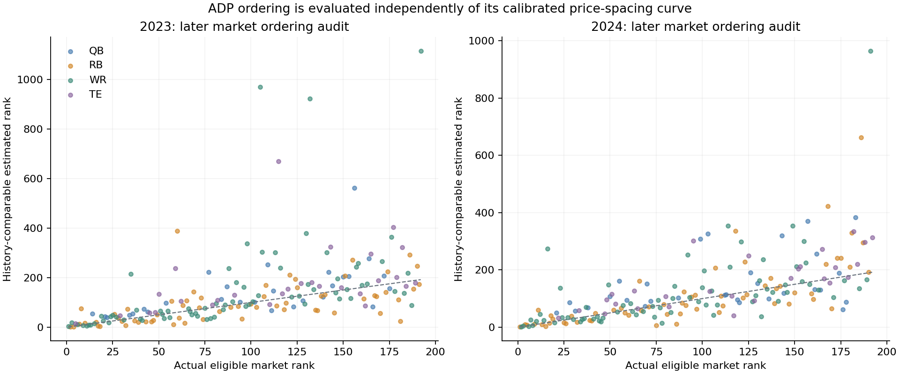
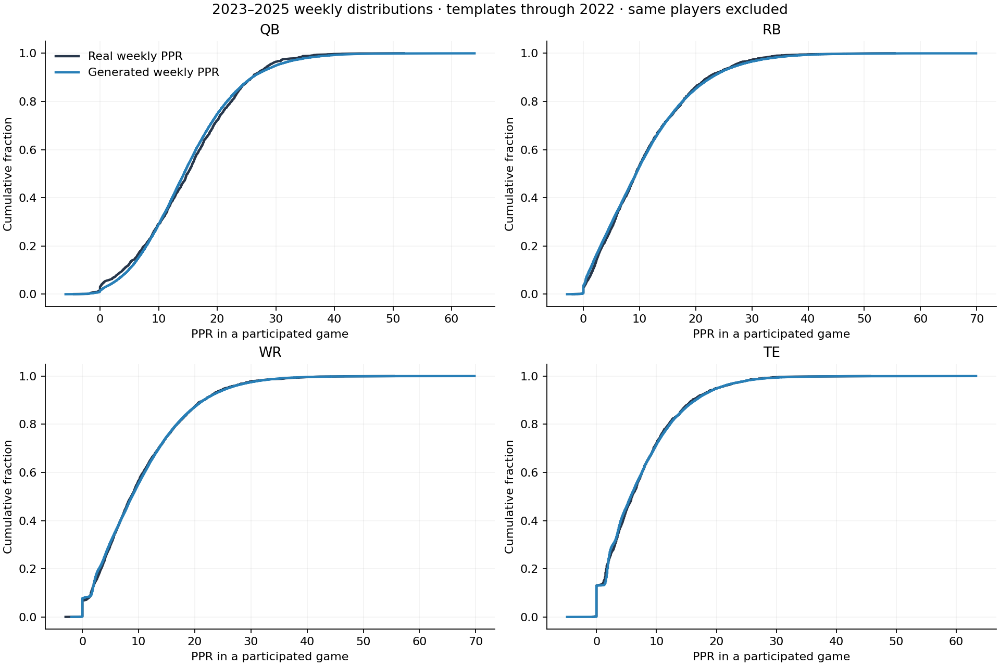
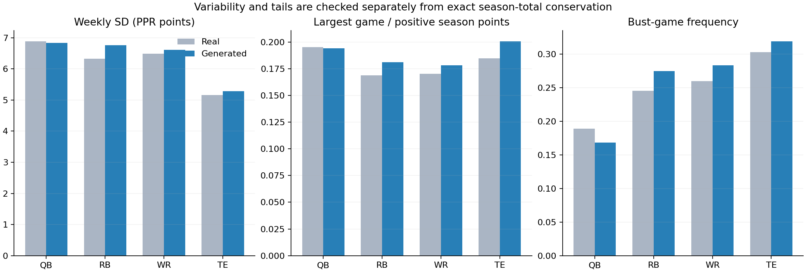
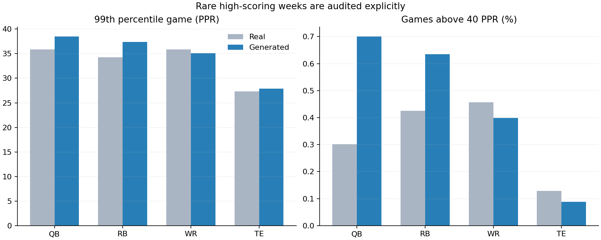
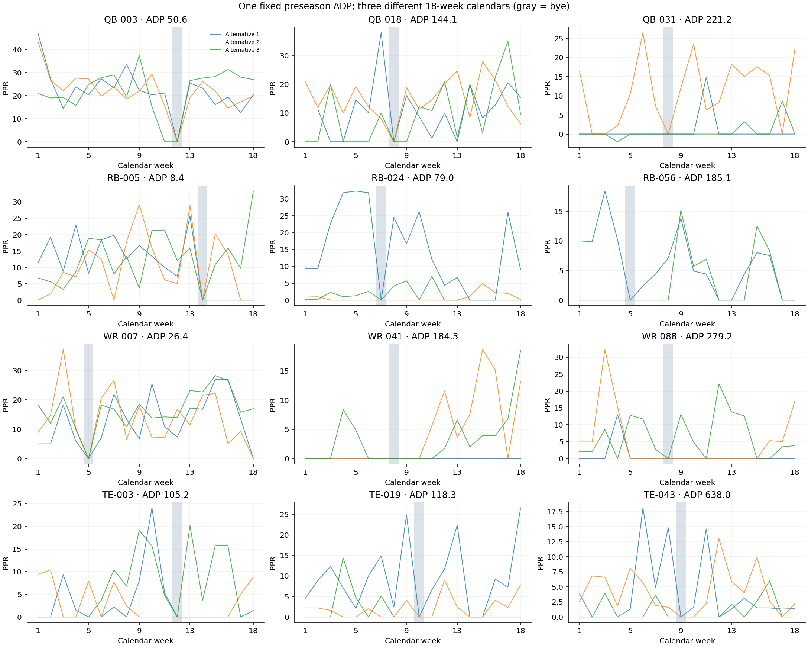

# ADP and weekly-results evidence

Open [the standalone explorer](DRAFT_WEEKLY_EXPLORER.html) to inspect every priced player, historical comparables and three alternative 18-week calendars.

## ADP: a history-only market model

Data: pinned public community archive of FantasyPros overall consensus, 2015–2024. 2015 is downloaded for provenance; fitting starts in 2016 because NFL histories begin in 2015. The archive does not certify scoring or league size. It is **not claimed as a verified pure-PPR, 12-team feed**. Updated team/position labels are ignored; NFL identities and positions are independently joined. All top-216 source players in 2016–2024 are resolved. The two unmatched top-216 rows in 2015 are outside this NFL observation window. Repairs and unresolved tail rows are exported.

Comparables use only histories available before each draft year: age, calendar-aligned 1/2/3-year production, volume/style, games, documented OUT weeks and elapsed time since offensive production. Rare gadget throws do not dominate non-QB comparisons. Missing market prices are censored, not fabricated observations. All drafted rookies are included as preseason candidates, including unpriced ones.

The learned ordering is evaluated on 2023–2024 ADP targets excluded from fitting. Neighborhood selection uses 2020–2022 only. These are historical audits; identity/calendar bugs were diagnosed during development, so they are not described as blind external tests. Rookie scouting, camp news and current medical reports are absent, making exact individual prices uncertain.

| draft_year | cohort | n_observed_top192 | rank_spearman | rank_mae | top24_overlap | top60_overlap | top120_overlap |
| --- | --- | --- | --- | --- | --- | --- | --- |
| 2023 | all | 192 | 0.74 | 62.89 | 0.71 | 0.77 | 0.80 |
| 2023 | has_prior_nfl_history | 168 | 0.78 | 50.76 | 0.71 | 0.77 | 0.80 |
| 2024 | all | 192 | 0.76 | 53.24 | 0.58 | 0.75 | 0.82 |
| 2024 | has_prior_nfl_history | 166 | 0.81 | 36.40 | 0.58 | 0.75 | 0.82 |

Rank correlation and mean error are cohort-specific; top-24/60/120 overlap is the complete board overlap for that draft year, repeated for reference.

Position mix among the first 192 eligible players (K/DST excluded) is shown separately. The generated board somewhat overrepresents QB/TE and underrepresents WR near the draft margin. This is a remaining market-composition bias; no positional quota was imposed to hide it.

| position | historical_min | historical_median | historical_max | generated_top192 | generated_expected_drafted |
| --- | --- | --- | --- | --- | --- |
| QB | 24 | 28.00 | 30 | 34 | 31.73 |
| RB | 62 | 63.00 | 68 | 58 | 61.49 |
| WR | 70 | 74.00 | 76 | 67 | 67.01 |
| TE | 25 | 26.00 | 28 | 33 | 31.77 |

Price spacing is calibrated to historical consensus curves; that distribution match is a construction constraint, not independent validation. ADP is the mean rank in 1,000 complete preference queues, with the first 192 counted as drafted. It is not conditional ADP among selected reserves: an always-undrafted player still has a queue rank. The room noise (.12/.18/.25 on log priority by tier) is a game setting, not empirically measured within-room variance. Values beyond the supported market range are explicitly extrapolated queue positions. The default display is 12 teams × 16 rounds; K/DST are removed from eligible ranks.

## Weekly results: known totals, realistic paths

There are 18 calendar weeks, at most 17 participated games, and one shared schedule-group bye. Whole observed availability sequences preserve missed-time clusters. Two-game blocks preserve local game patterns. Integer capacity allocation and signed-yardage allocation preserve every season total, including negative yardage and real lateral/strip-fumble edge cases. Byes and nonparticipation have zero production. Nonparticipation is not labeled automatically as injury.

Templates emphasize the main positional workload. Where compatible sources exist, productive roles require source opportunities per game within a factor of two. Gadget rushing is downweighted for receivers and tight ends. This prevents a reserve’s one busy game from being magnified into a much busier role.

Touchdowns, interceptions and lost fumbles are drawn conditionally on season counts using smoothed per-opportunity historical rates, then allocated within event capacities. This avoids magnifying one observed touchdown into an implausible single-game pileup. Yardage uses positive-part scaling while retaining empirical negative plays; it does not invent large negative games to force a lower positive season total.

Initial development showed excessive variability. Two moment-matching corrections, learned only on 2021–2022 with templates ending in 2020, regularize multivariate weekly shapes toward season baselines. The final 2023–2025 audit uses templates ending in 2022 and excludes the same player entirely. Only reconciled single-team seasons are audited; traded-team calendars are not silently treated as unambiguous byes.

Audited **756 real player-seasons**, with **15,120 generated paths**. Passed **52/52** practical distribution gates. Every path conserves totals. Bootstrap difference intervals resample whole players to preserve repeated-season dependence.

Separately exercised **all 6,663 reconciled source seasons**, including depth players and lateral/strip-fumble exceptions: **0 accounting failures**.

| position | metric | real | generated | difference_ci_low | difference_ci_high |
| --- | --- | --- | --- | --- | --- |
| QB | cv | 0.53 | 0.51 | -0.05 | 0.01 |
| QB | weekly_sd | 6.88 | 6.84 | -0.38 | 0.28 |
| QB | max_share | 0.20 | 0.19 | -0.01 | 0.01 |
| QB | bust | 0.19 | 0.17 | -0.04 | -0.00 |
| RB | cv | 0.63 | 0.69 | 0.03 | 0.07 |
| RB | weekly_sd | 6.33 | 6.76 | 0.24 | 0.62 |
| RB | max_share | 0.17 | 0.18 | 0.01 | 0.02 |
| RB | bust | 0.25 | 0.27 | 0.01 | 0.04 |
| TE | cv | 0.68 | 0.71 | 0.01 | 0.06 |
| TE | weekly_sd | 5.15 | 5.29 | -0.02 | 0.29 |
| TE | max_share | 0.18 | 0.20 | 0.01 | 0.02 |
| TE | bust | 0.30 | 0.32 | 0.01 | 0.03 |
| WR | cv | 0.66 | 0.69 | 0.01 | 0.05 |
| WR | weekly_sd | 6.48 | 6.61 | -0.04 | 0.30 |
| WR | max_share | 0.17 | 0.18 | 0.00 | 0.01 |
| WR | bust | 0.26 | 0.28 | 0.01 | 0.04 |

CV is regularized as SD / max(abs(mean), 5) to avoid unstable ratios for tiny fantasy roles. Raw SD in PPR points is reported separately. A boom is above 1.5× the player’s active-game mean; a bust is below 0.5× that mean. Game concentration uses positive fantasy points.

| position | metric | real | generated | error | limit | passed |
| --- | --- | --- | --- | --- | --- | --- |
| QB | pooled_p99 | 35.89 | 38.50 | 0.07 | 0.20 | True |
| QB | over40_rate | 0.00 | 0.01 | 0.00 | 0.01 | True |
| QB | pooled_p999 | 43.24 | 49.26 | 0.14 | 0.20 | True |
| QB | over60_rate | 0.00 | 0.00 | 0.00 | 0.00 | True |
| RB | pooled_p99 | 34.28 | 37.40 | 0.09 | 0.20 | True |
| RB | over40_rate | 0.00 | 0.01 | 0.00 | 0.01 | True |
| RB | pooled_p999 | 48.86 | 50.06 | 0.02 | 0.20 | True |
| RB | over60_rate | 0.00 | 0.00 | 0.00 | 0.00 | True |
| WR | pooled_p99 | 35.88 | 35.10 | 0.02 | 0.20 | True |
| WR | over40_rate | 0.00 | 0.00 | 0.00 | 0.01 | True |
| WR | pooled_p999 | 46.50 | 47.30 | 0.02 | 0.20 | True |
| WR | over60_rate | 0.00 | 0.00 | 0.00 | 0.00 | True |
| TE | pooled_p99 | 27.34 | 27.90 | 0.02 | 0.20 | True |
| TE | over40_rate | 0.00 | 0.00 | 0.00 | 0.01 | True |
| TE | pooled_p999 | 40.12 | 39.32 | 0.02 | 0.20 | True |
| TE | over60_rate | 0.00 | 0.00 | 0.00 | 0.00 | True |

Tail limits require pooled 99th- and 99.9th-percentile PPR within 20%, the rate above 40 PPR within 0.5 percentage points, and the rate above 60 within 0.025 percentage points. These are declared game-realism tolerances, not confidence bounds; extreme real samples are sparse. The same historical audit informed mechanism repairs, so this is not an untouched external test. No outcomes were clipped to pass these checks.

Conservation makes mean weekly points automatic given season totals and games. The independent checks concern variability, game concentration, tails, boom/bust frequencies, lag correlation and missed-participation streaks. The acceptance limits are explicit in the CSV and do not establish exact distributional equality.

Exported **7,110 complete calendars** (127,980 weekly rows), including every player in the first three generated league seasons. Shared byes coordinate schedule groups; shared-team play-by-play, opponents and weather remain outside scope.

[Full priced database](player_database_with_adp.json) · [Draft board CSV](generated_adp.csv) · [All weekly rows, gzip CSV](weekly_results.csv.gz) · [Exact export checks](weekly_export_checks.json)
