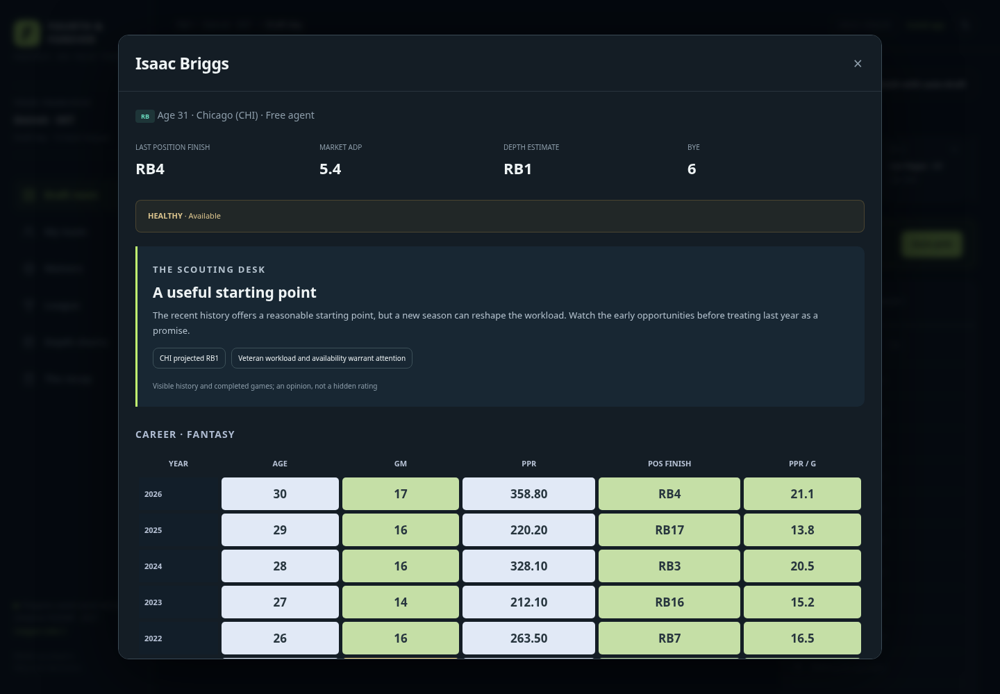
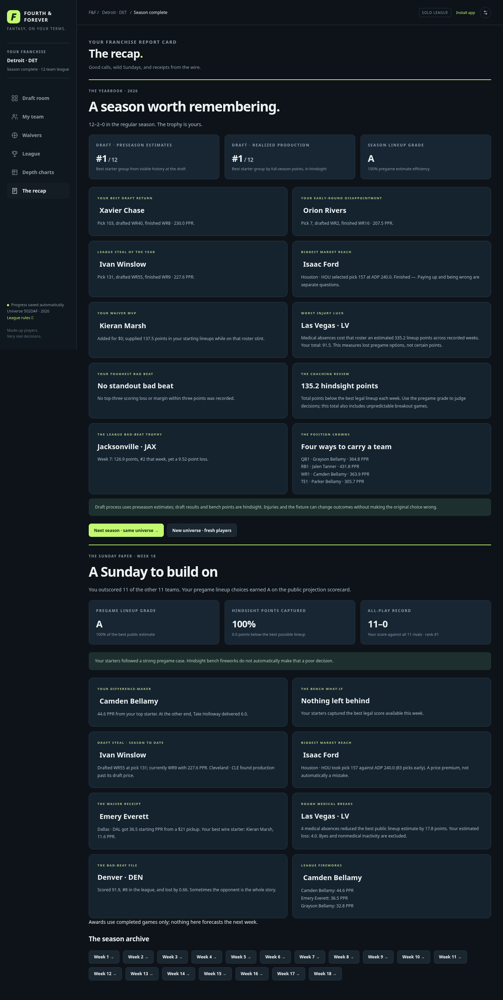
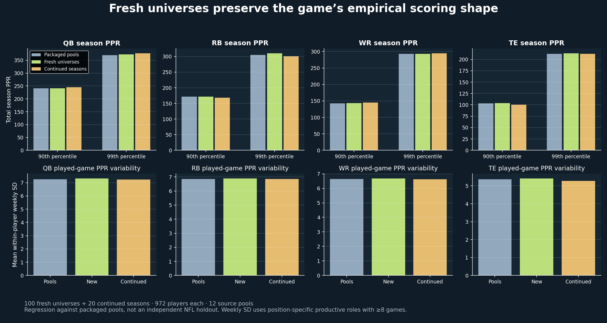

# Player careers, universes and the Sunday paper

[Play the browser game](https://tyler-wadekamper.github.io/ff-game/index.html?v=3).

Player cards now show season PPR finishes (WR1, QB23), current ranks through completed weeks, and separate passing, rushing and receiving tables. Competition ties share a finish; zero-opportunity seasons have none. The colored cells compare the same position and season, using a starter/depth reference group for statistics and minimum samples for efficiency rates. Completed finishes remain fixed when players retire in later years.



Procedural scouting notes use visible histories, age, recent opportunities, completed scoring and current availability. Conditional language reflects uncertainty. Reopening a card cannot reroll a scouting opinion, and hidden future scores do not enter its classification. Depth charts cover all 32 city markets and estimate roles from public usage.

## Weekly and yearly feedback

Every kickoff records active players, IR, starters, actual points and public pregame estimates. The weekly **Sunday Paper** includes:

- Your all-play record and scoring rank, close losses, high-scoring losses and fortunate low-scoring wins.
- A pregame lineup grade, plus a separate hindsight score and bench what-if.
- Your best starter and quietest starter, the league’s scoring fireworks and waiver contributions.
- Draft return relative to positional draft cost, market reaches relative to ADP, and medical roster impact.

The **Yearbook** adds preseason versus realized draft-class ranks, your best draft return and early-round disappointment, waiver MVP, positional scoring leaders, injury luck, coaching totals, and personal/league bad beats. Draft-class comparisons use the best legal starting group from the players originally drafted. A market reach measures price paid, not proof of a bad outcome. Awards before Week 4 are explicitly provisional.

Lineup grade is chosen pregame estimated points divided by the best legal estimated lineup: A ≥95%, B ≥85%, C ≥70%, D ≥50%, F below. Hindsight points compare the locked starters with that week’s best legal active-roster lineup. Injury impact compares the best public lineup estimate with and without current medical absences, excluding byes and nonmedical inactivity. These are transparent game scorecards, not independently calibrated measures of managerial skill or certain points lost.

Weekly archives preserve the locked roster context after later transactions. Older saves recover completed player scoring from their stored football world, while unavailable old coaching/medical snapshots remain explicitly missing.



## Roster and universe choices

There are **14 draft rounds / 168 picks**, eight starters, **six bench spots and two IR spots**. Medical OUT/IR players qualify for fantasy IR. A bye or uncertain game-day role does not qualify. The UI shows an uncertain return range and the IR designation where appropriate. Healthy players must return to the active roster or be released before pickups or kickoff. An IR move creates a real active-roster opening; a replacement pickup can use it without dropping another player. Bots manage the same limits.

Older sixteen-player saves preserve the human’s players for explicit trimming or eligible IR moves. A draft already beyond Round 14 opens roster management instead of getting stuck.

- **Resume:** reopen the exact saved season.
- **New universe:** regenerate identities, connected histories, ages, history-based ADP, club assignments and football outcomes.
- **Next season · same universe:** retain player identities, append the completed season, preserve positional finishes, age the league, introduce a rookie class and redraft. Earlier seasons remain separate saves.

The generator matches visible role/history states to a whole empirical pool one-to-one, applies bounded 0.92–1.08 stat-vector variation, and rearranges played-game blocks around a shared city bye. It does not select good successors using their future results. A new universe is a procedural remix of the empirical library, rather than a new independent NFL sample.

The medical labels, uncertain assessment noise and age/absence turnover rules are declared game layers. Participation and scoring originate in the empirical pools; causal medical injuries and long-term career demography have not received a new independent historical audit. Shared NFL team play-by-play remains outside the model.

## Executed checks

- **42 Node tests** cover engine rules, all draft slots, positional ranks/ties, reserve ownership/capacity, recovered-player enforcement, regeneration/reconstruction, continuation, frozen finishes, older-save migration, past-only scorecards, authorization and concurrent revisions.
- **50 Python tests** pass for the existing empirical data, history, ADP and weekly models.
- **240 complete drafts / 120 complete seasons** verify legal teams, budgets, schedules and playoffs.
- **100 fresh universes + 20 continued seasons / 116,640 player-seasons:** 64 distribution regression gates pass against the twelve packaged source pools. Checks cover population, season PPR totals/quantiles, participation, weekly scoring variability and ≥40-point games. Near-zero medians allow an absolute 1.2 PPR tolerance instead of unstable percentages; rare-event rates have a wider declared tolerance. These are regression checks, not a fresh NFL holdout.
- **72 market parity cases:** browser features agree with Python to floating-point precision; the largest log-priority difference from the independent sklearn kernel is below 0.000001.
- Chromium exercises a complete season at desktop/mobile sizes. The static version plays all 18 weeks offline, restores a full backup in another browser, uses IR and an open-slot pickup, opens recap archives, continues the universe and generates a fresh universe. JavaScript and HTTP error lists are retained in the check files.



[Distribution results](universe_audit.json) · [Metrics CSV](universe_metrics.csv) · [Market parity](browser_market_parity.json) · [Browser acceptance](static_browser_checks.json)

```sh
npm test
npm run test:browser
npm run test:static
npm run validate:game
npm run validate:universes
npm run validate:market
.venv/bin/python -m unittest discover -s tests -v
```
