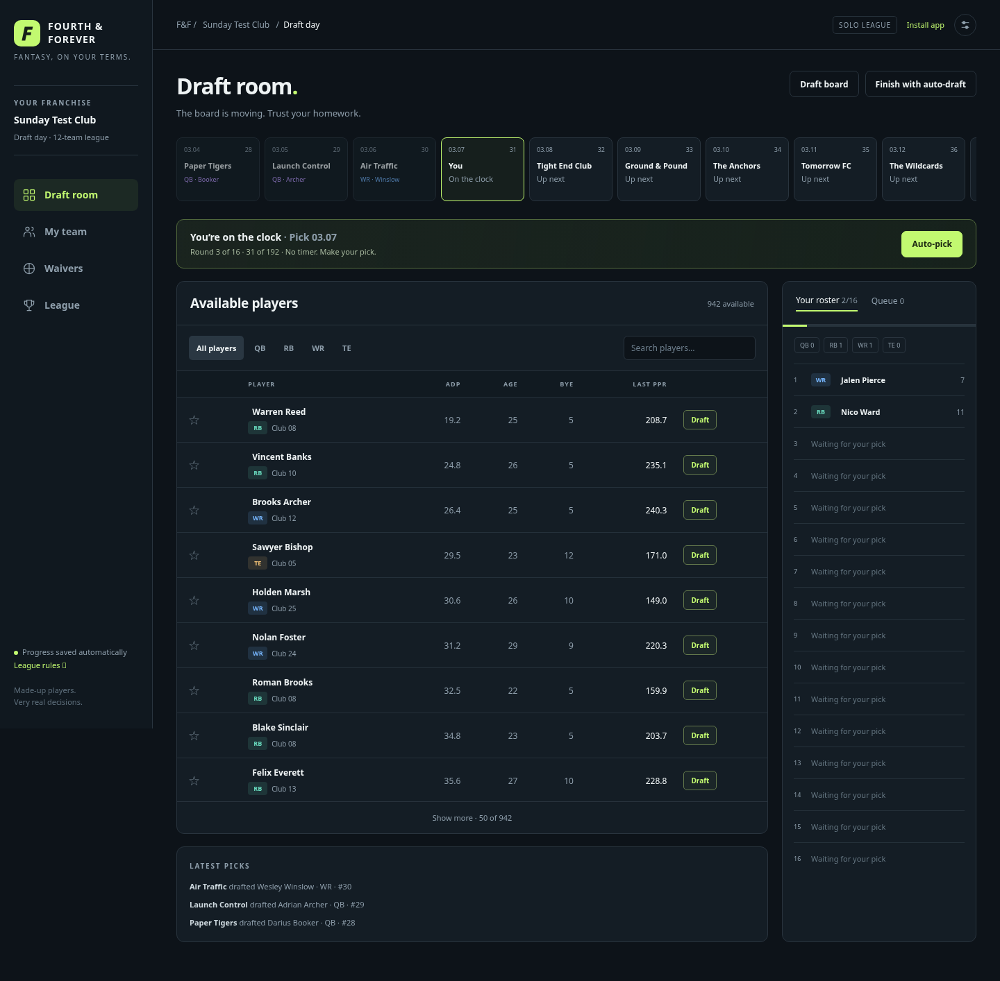
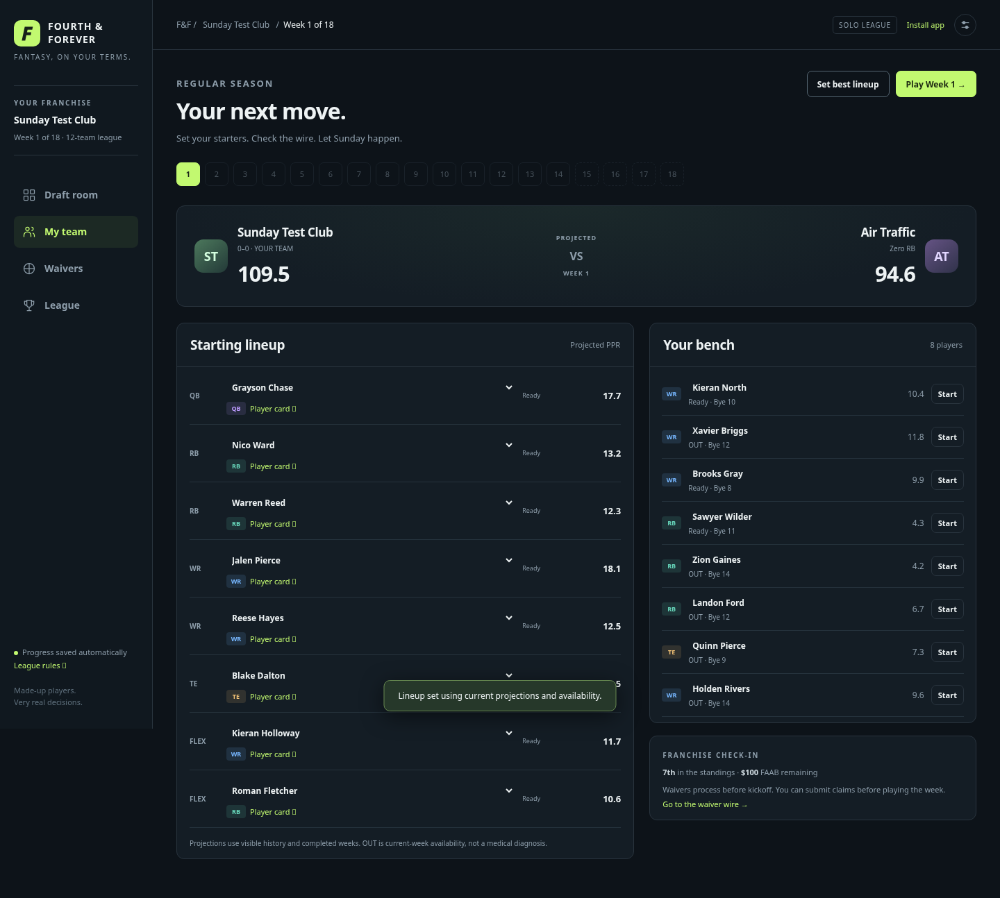
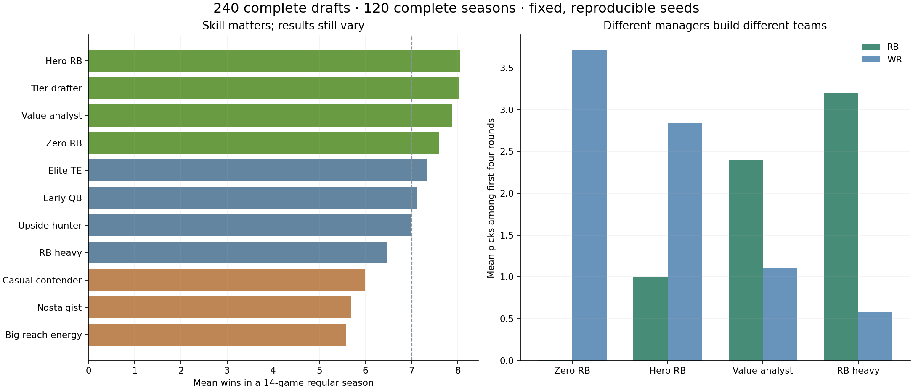
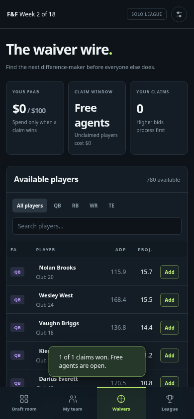

# Fourth & Forever: executed gameplay evidence

Run `npm ci` then `npm start`, and open http://localhost:3000. The browser game supports desktop and phones; it has an installable PWA shell. Gameplay requires the server.

[Rules, strategy research, platform/revenue decision and architecture](../docs/GAME_DESIGN.md)

## What is playable

A 192-pick, twelve-team snake draft with queue, manual picks, auto-picks and a complete draft board. Eleven managers have distinct strategies and skill/noise settings. Eight starting slots and eight bench spots can be managed manually. Weekly play locks lineups, scores all matchups, updates standings, processes contested $100 FAAB waivers, runs the six-team playoffs and records a champion. Week 18 is an exhibition. Saves survive reloads and server restarts; recovery files resume on the same server.

## Validation that actually ran

- **240 complete drafts / 46,080 selections.** Every roster completed legally, with no duplicate ownership.
- **120 complete seasons / 2,160 advances.** All ran through Week 18 with legal rosters, nonnegative budgets, playoffs and a champion.
- **30 Node tests** cover the engine and HTTP behavior: all draft slots, positional legality, exact cent scoring, locked snapshots, bids/ties/overcommitment, dropped-player cooldown, deterministic resume, playoff byes/reseeding/ties, save persistence, authentication and concurrent stale revisions.
- **A full browser season** exercised queue/manual/auto drafting, profiles, lineup swaps, waivers with a $100 winning bid, mobile navigation, reload/resume, all 18 advances, standings and the championship. No JavaScript or HTTP errors were observed.
- **12 packaged football worlds / 11,664 player calendars / 209,952 weekly rows.** Export reconciled every player to its generated season totals; tests independently verify weekly PPR accounting and bye/nonparticipation zeros.
- Future results, private worlds, server files and saved league files have no public HTTP route. Draft choices remain identical when the hidden world changes. Lineup choices remain identical when hidden points change but published availability does not.

## Are the opponents different, and does skill matter?

The table reports repeated game simulations, not observed human-manager frequencies or evidence of a universally optimal fantasy strategy. The human slot was also auto-managed for these comparisons, and rotated across draft positions. These are descriptive averages across the twelve packaged football worlds; they are not confidence intervals.

| style | meanFirst4RB | meanFirst4WR | meanProjectedStarterPpg | meanReachPicks | meanRegularSeasonWins | championships |
| --- | --- | --- | --- | --- | --- | --- |
| Hero RB | 1.00 | 2.84 | 114.09 | 18.07 | 8.04 | 22 |
| Tier drafter | 2.05 | 1.26 | 119.08 | 12.64 | 8.03 | 20 |
| Value analyst | 2.40 | 1.11 | 117.16 | 12.34 | 7.88 | 15 |
| Zero RB | 0.01 | 3.71 | 113.59 | 19.49 | 7.60 | 10 |
| Elite TE | 1.93 | 0.96 | 113.63 | 21.05 | 7.34 | 8 |
| Early QB | 1.71 | 1.08 | 111.84 | 25.94 | 7.11 | 10 |
| Upside hunter | 2.26 | 1.30 | 110.36 | 22.63 | 6.99 | 8 |
| RB heavy | 3.20 | 0.58 | 108.84 | 26.08 | 6.46 | 5 |
| Casual contender | 1.73 | 1.56 | 106.03 | 34.96 | 5.99 | 4 |
| Nostalgist | 1.55 | 1.62 | 105.88 | 38.37 | 5.68 | 4 |
| Big reach energy | 1.59 | 1.49 | 100.60 | 42.50 | 5.58 | 2 |

The Hero RB manager averages about one RB in its first four picks; the Zero RB manager nearly always delays RB beyond those rounds. The RB-heavy manager averages more than three early RBs. Wildcards reach farther down the ADP board than disciplined value managers. Stronger managers build better publicly estimated starting lineups on average, while the weaker styles still win some championships. No winner is scripted.

## Mobile and limits

This is a local, single-process prototype with twelve packaged football worlds, not a public commercial launch. It does not connect payments, simulate dynasty offseasons or trades, or add causal medical injuries/team play-by-play. It retains the documented ADP source-format, positional-margin and rare weekly-tail biases from the research model. Manager preferences and noise are game-design choices, not calibrated human behavior.

[Playtest JSON](game_playtest.json) · [Bot metrics CSV](game_bot_metrics.csv) · [Browser checks](game_browser_checks.json) · [World export checks](game_data_checks.json)
