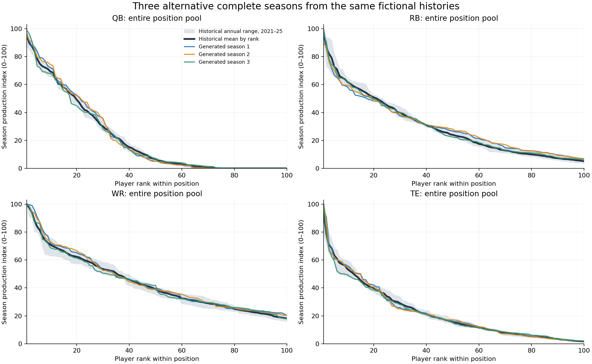
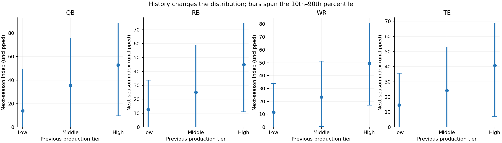
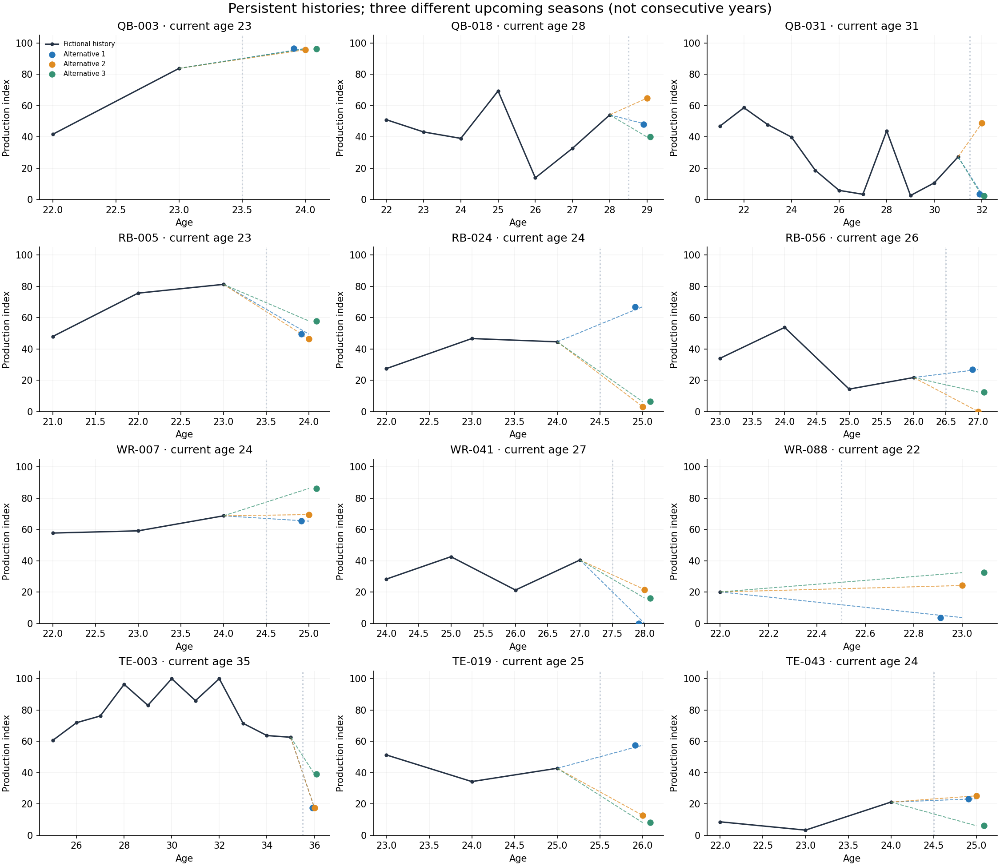

# A distribution-first fictional NFL season generator

**Purpose:** believable new seasons given fictional player histories. Individual forecasting accuracy is secondary.

Data: 3,164 real players and 10,468 player-seasons, 2015–2025, from free [nflverse release assets](https://github.com/nflverse/nflverse-data/releases). [Source URLs/checksums](source_manifest.json) and [coverage audit](coverage.json) are retained.

Executed 100 complete population simulations. **69/69 statistical realism gates passed.** These are empirical acceptance checks, separate from the software test suite.

## What changed

1. Removed independent log-stat extrapolation. A positive historical successor can no longer disappear because a numerical adjustment goes negative.
2. Assign one complete modern NFL outcome pool per season, with stochastic one-to-one matching based on age, opportunity style, recent history and participation. NFL-sized role/opportunity supply is limited.
3. Include complete empirical new-entrant cohorts and explicit next-roster status. Career exits are not labeled injuries.
4. Perturb full game vectors within successor seasons at 25% strength to create new lines while retaining workload/efficiency relationships. The game does not hard-cap passing attempts or clip production to historical maxima.
Negative net yardage is preserved; only event counts are constrained to be nonnegative.
5. Keep the same persistent perturbation throughout each fictional history, then allocate upcoming outcomes without inspecting those outcomes in the matching cost.

The production ecology is drawn from **2021–2025**, the 17-game era; **all 2015–2025 data** still supplies histories and conditional transition comparisons. Population-level realism is a deliberate design constraint, not an independent statistical discovery.

## Reading the 0–100 score

`score = min(100, max(0, 100 × PPR / position_reference))`

The reference is the position’s 99th-percentile fantasy-relevant season PPR from **2015–2022**, fixed before this work. A 50 is half that production, not the 50th percentile. Scores are not re-ranked every season. The same score at different positions does not imply equal raw fantasy value. Values above the display ceiling retain their complete raw PPR in the data and raw-PPR graphs. This is a production index, not a hidden ability rating.

| position | PPR_at_score_100 |
| --- | --- |
| QB | 412.60 |
| RB | 393.21 |
| WR | 349.86 |
| TE | 297.11 |

## Position distributions

Ranks 1–100 include the entire position pool and new entrants. The gray band is the observed annual range, not a confidence interval. The three colored curves are simulations 1, 2 and 3, selected in advance; no favorable seasons were picked.

[Raw PPR version](position_distributions_ppr.png)

| position | rank_curve_error_score | top12_error_score | historical_zero_active | generated_zero_active | historical_opportunities | generated_opportunities |
| --- | --- | --- | --- | --- | --- | --- |
| QB | 0.15 | 0.41 | 0.35 | 0.36 | 18001.60 | 17984.74 |
| RB | 0.23 | 0.46 | 0.34 | 0.34 | 11827.20 | 11830.90 |
| WR | 0.23 | 0.01 | 0.44 | 0.44 | 10250.40 | 10248.29 |
| TE | 0.17 | 0.08 | 0.42 | 0.42 | 3792.80 | 3783.19 |

The population margin checks measure whether the implementation reproduces its empirical design target. They cannot, by themselves, show that assigning those outcomes to individual histories is realistic. The next checks address that distinction.

## Histories still matter

Low/middle/high are previous-production thirds among incumbents above 30 PPR. Conditional means must be ordered, and individual players must retain substantial uncertainty and novel positive stat lines. Age, recent workload style and recorded participation enter matching; age effects are empirical associations, not a medical or causal model.

## Inspect fictional players

| player | age | recent_scores | next_A | next_B | next_C | PPR_p10 | PPR_p90 |
| --- | --- | --- | --- | --- | --- | --- | --- |
| QB-003 | 23 | 42, 84 | 96.50 | 95.70 | 96.30 | -0.84 | 388.93 |
| QB-018 | 28 | 14, 33, 54 | 48.00 | 64.80 | 40.00 | 33.96 | 279.39 |
| QB-031 | 31 | 3, 11, 27 | 3.60 | 48.90 | 2.40 | 0.00 | 138.23 |
| RB-005 | 23 | 48, 76, 81 | 49.40 | 46.40 | 57.80 | 181.47 | 365.73 |
| RB-024 | 24 | 27, 47, 44 | 66.90 | 3.10 | 6.30 | 0.00 | 223.20 |
| RB-056 | 26 | 54, 14, 22 | 26.80 | 0.00 | 12.40 | 0.40 | 216.30 |
| WR-007 | 24 | 58, 59, 69 | 65.30 | 69.50 | 86.20 | 149.71 | 308.18 |
| WR-041 | 27 | 43, 21, 40 | 0.00 | 21.60 | 16.20 | 13.20 | 98.58 |
| WR-088 | 22 | 20 | 3.70 | 24.20 | 32.40 | 10.00 | 169.44 |
| TE-003 | 35 | 72, 64, 63 | 17.40 | 17.40 | 39.00 | 0.00 | 206.10 |
| TE-019 | 25 | 51, 34, 43 | 57.50 | 12.70 | 8.10 | 24.74 | 175.13 |
| TE-043 | 24 | 9, 3, 21 | 23.30 | 25.20 | 6.10 | 8.30 | 79.10 |

[Raw PPR histories](player_histories_ppr.png) · [Full player JSON](generated_players.json) · [Three entire generated seasons](three_generated_seasons.csv)

Each row shows three alternative upcoming seasons from the same history. They are not three consecutive seasons. All examples are chosen from fixed previous-production strata before drawing their outcomes. Histories can be truncated at 2015; a first visible year is not necessarily a rookie year.

## Reliability protocol and remaining scope

The same complete-game engine was also replayed against 2023–2025 incumbent histories, fitting only through 2022. This is separate from the construction-target plots above. It uses 64 complete season draws per year:

| position | n | actual_mean | generated_mean | actual_zero_ppr | generated_zero_ppr | actual_no_production | generated_no_production | actual_p90 | generated_p90 | wasserstein_ppr |
| --- | --- | --- | --- | --- | --- | --- | --- | --- | --- | --- |
| QB | 141 | 139.83 | 151.65 | 0.11 | 0.14 | 0.10 | 0.14 | 315.12 | 327.29 | 12.63 |
| RB | 191 | 129.77 | 122.51 | 0.09 | 0.08 | 0.09 | 0.08 | 266.70 | 247.59 | 7.68 |
| TE | 148 | 94.61 | 87.95 | 0.05 | 0.10 | 0.05 | 0.10 | 182.58 | 172.00 | 10.45 |
| WR | 300 | 124.54 | 124.65 | 0.05 | 0.09 | 0.05 | 0.07 | 240.31 | 250.51 | 6.23 |

This reused audit still differs from the exact later NFL cohorts, especially their absence/exit rates. A fictional game is calibrated to plausible historical outcomes, not to recreating the particular next real season. These differences remain visible rather than being erased by annual percentile rescaling.

- Simulator settings were selected on 2019–2022 forward-only development folds using pooled and history-conditional distribution distances, not individual prediction error. Zero-jitter copying is reported as an ablation and excluded from procedural settings.
- The conditional 2023–2025 audit remains available in the CSVs. Those years were already inspected during v1, so this is a reused historical audit, not a newly untouched test set. Its remaining era/cohort discrepancies are not concealed by the population-matching plots.
- The complete-game margin gates check raw opportunities and raw PPR as well as the display index, seed batches, dropout ranges and history dependence. None can be made to pass merely by normalizing scores separately each year.
- The gray historical band describes annual variation; this generator resamples a finite historical source, so it cannot establish reliability under an unprecedented football regime.
- Weekly injury reports still do not identify complete injury-caused absence or individual recurrence hazards. The engine reproduces empirical participation/out-of-production patterns without claiming to have fitted a medical durability model.
- This is a complete player-pool/season-stat generator. It does not yet simulate shared team play-by-play, enforce identical QB/receiver totals within each fictional offense, run a fantasy draft, or validate long multi-decade careers.
- The game-facing JSON contains fictional IDs and no source names, teams or GSIS IDs. It is not formal anonymization; a historical shape may remain recognizable.

[Every realism gate](realism_checks.csv) · [Complete-game historical audit](balanced_historical_audit.csv) · [Parameter summaries](parameter_summary.csv) · [Full fictional database](player_database.json)

Open [the standalone interactive report](SEASON_EXPLORER.html) to switch score/PPR views and inspect each history and alternative stat line. It embeds all images and data and requires no server or network.
