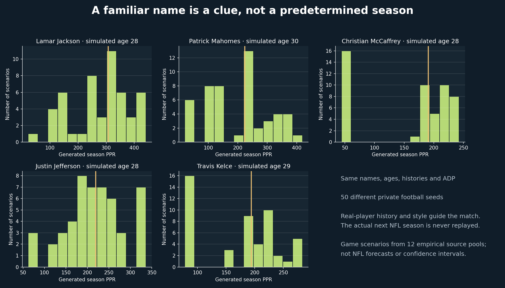
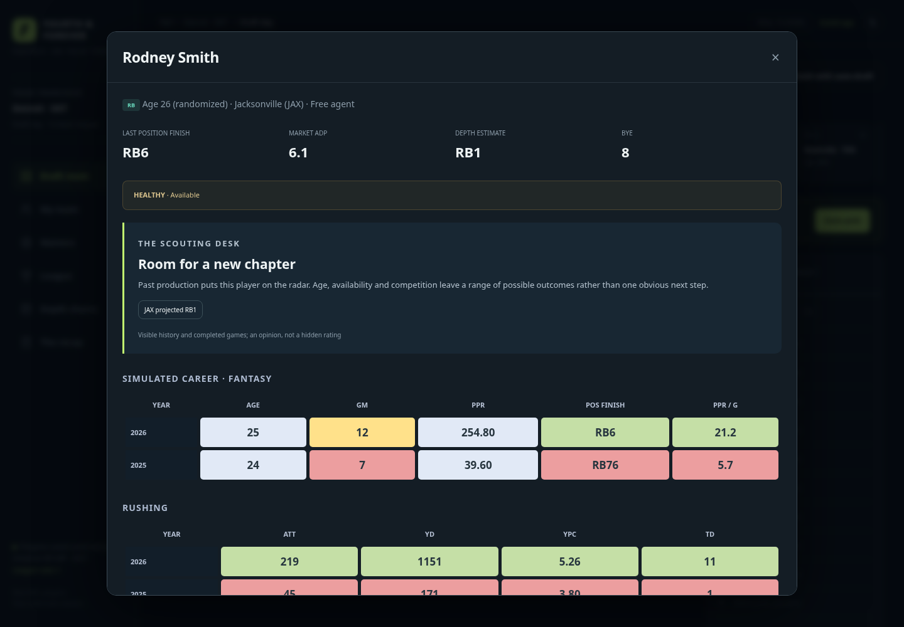

# Real NFL players, alternate careers

[Play Fourth & Forever](https://tyler-wadekamper.github.io/ff-game/index.html?v=4). Choose **New universe** to use real players. Existing fictional universes retain their original identities and results.

Each fresh universe contains **972 distinct real NFL identities**, drawn from **2,752 players / 10,001 recorded career checkpoints** in the cached 2015–2025 nflverse data. Names, positions and original checkpoint statistics are independently reconciled against that panel. Players without supported age metadata are excluded from this identity library.

The displayed age is randomized around a sampled career checkpoint, with a coherent age for every previous season. Each player's visible history comes from **that same player's career**, converted to the game's 17-game schedule and given a small, persistent 0.92–1.08 stat-vector perturbation. The calendar labels, city, age and statistics describe an alternate career, rather than actual NFL calendar-year totals. Pre-2015 career stages are outside this library.

## How the game keeps familiar traits without replaying results

1. Place five familiar faces—Lamar Jackson, Patrick Mahomes, Christian McCaffrey, Justin Jefferson and Travis Kelce—into compatible historical role slots after sampling their career checkpoints.
2. Fill the remaining slots with distinct real players/checkpoints matched to the existing league's historical role mix. Per-game production, opportunities, age, rushing, receiving usage and participation determine similarity. This avoids creating a league with an unrealistic surplus of established stars.
3. Price the resulting histories with the existing historical-comparable ADP model. Reputation and the player's actual later NFL seasons do not set the draft price.
4. Use a separate, private football seed to allocate one complete empirical future pool, one-to-one, using only the simulated past. Real-player matching emphasizes sustained scoring and career age alongside workload/style. Apply bounded joint variation and rearrange played-game blocks around the city bye. The named player's actual next historical season is never replayed as the game outcome.
5. Continue-universe mode preserves identities, adds the completed simulated season to history and advances age. Retired names are tracked so the same real identity cannot return as a new rookie. Later entry cohorts use unused real names; if the finite historical identity pool eventually runs out at a position, clearly marked fictional future prospects keep the universe playable.

A name is informative because the history belongs to that player. It is not a promise of another real-life breakout or championship. The full NFL-sized scoring and opportunity pool remains constrained; independently giving every famous player an elite season would distort the league.

## One roster, fifty different future seasons

The following experiment held **every name, age, history and ADP exactly fixed** and changed only the private football seed. The columns summarize 50 game scenarios; they are not NFL forecasts or calibrated probability intervals.

| Player | Simulated age | P10 PPR | Median PPR | P90 PPR | Distinct totals |
| --- | ---: | ---: | ---: | ---: | ---: |
| Lamar Jackson | 28 | 133.1 | 307.3 | 420.8 | 49 / 50 |
| Patrick Mahomes | 30 | 25.7 | 223.7 | 346.6 | 50 / 50 |
| Christian McCaffrey | 28 | 46.4 | 190.8 | 229.1 | 48 / 50 |
| Justin Jefferson | 28 | 133.8 | 219.3 | 321.1 | 50 / 50 |
| Travis Kelce | 29 | 82.9 | 193.9 | 254.1 | 49 / 50 |



The sample's Lamar profile retains more rushing production than the Mahomes profile on average, while both have substantial scoring variation. Fresh universes also vary the sampled ages and histories; this experiment deliberately kept those inputs fixed.

## Executed checks

- **48 Node tests:** real identity mapping, same-player historical lines, coherent ages, star-role balance, independent future scenarios, ADP/history isolation, identity retention, absence of duplicate recruits, full-season play, IR/waivers, HTTP/save behavior and exact legacy reconstruction.
- **51 Python tests:** the existing empirical model/accounting tests plus reconciliation of every real-library checkpoint to the cached NFL panel.
- **100 fresh real-player universes + 20 continued seasons:** all 64 distribution regression gates pass against the packaged source pools. This is a regression check, not a new independent NFL holdout.
- **144 market parity cases:** browser features and the independent Python/sklearn kernel agree to numerical precision; maximum log-priority difference is under 0.000002.
- **Desktop and phone browser seasons:** the real-player edition passes full-season play, offline play, IR replacement pickups, save/reload, cross-browser backup restore, depth charts, recaps, continuing a named universe and starting a fresh one. No JavaScript or HTTP errors were observed.
- Previously published fictional universes reconstruct the exact same catalogs and football outcomes in two successive seasons, checked against frozen hashes from the prior release.



The source library is finite, and matchup/medical narratives and long-term turnover remain game-design layers. Shared NFL team play-by-play and independently calibrated player-specific forecasts are outside this simulator.

[Scenario data](real_player_audit.json) · [Distribution audit](universe_audit.json) · [Browser acceptance](static_browser_checks.json) · [Market parity](browser_market_parity.json)

```sh
npm run data:real-players
npm test
.venv/bin/python -m unittest discover -s tests -v
npm run validate:real-players
npm run validate:universes
npm run validate:market
npm run test:browser
npm run test:static
.venv/bin/python game/tests/plot-real-players.py
```
