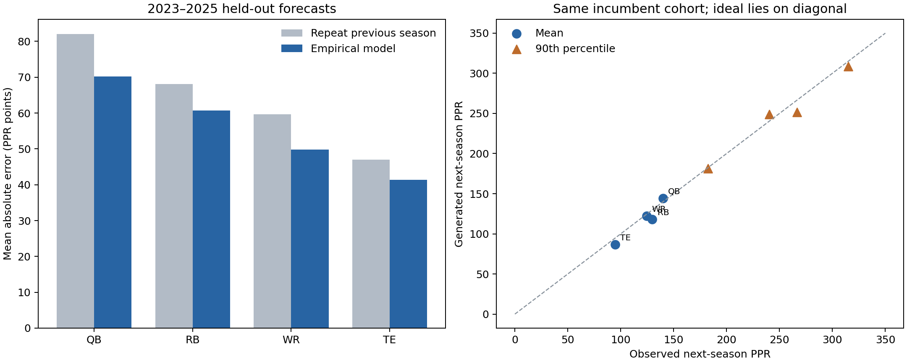

# NFL empirical player-model report

Generated from downloaded nflverse assets with seed `20261030`. Regular seasons 2015–2025 only. This is a tested empirical season-transition prototype, not the complete latent weekly model proposed in chat.

## Data and provenance

3,164 distinct players; 10,468 player-seasons across QB/RB/WR/TE; 45 source CSVs (140.0 MB). All 11 years have 32 teams and the expected final regular-season week in player stats and injury reports. Week/team presence does not prove every individual record is complete.

| position | players | player_seasons | relevant_seasons |
| --- | --- | --- | --- |
| QB | 336 | 1347 | 480 |
| RB | 817 | 2616 | 755 |
| WR | 1379 | 4254 | 1086 |
| TE | 663 | 2251 | 554 |

Free source: [nflverse-data releases](https://github.com/nflverse/nflverse-data/releases). Snap counts originate from Pro Football Reference. Source URLs, timestamps and SHA-256 hashes are in [source_manifest.json](source_manifest.json). Hashes pin our downloaded bytes; they are not publisher signatures. Underlying providers' terms and attribution requirements remain applicable to redistribution.

Annual rosters retain zero-production depth players; FB/HB are grouped into RB. Annual roster coverage can omit players absent from the snapshot, so this is not an exhaustive transaction/IR register. There are 437 missing ages, all among zero-opportunity seasons; model features impute those to 26. No missing ages occur among players with offensive opportunities. Games count recorded participation, including special teams, not confirmed healthy availability or starts. Identity joins and yearly gaps are in [coverage.json](coverage.json).

## Parameter ranges

Min/max are observed extremes, not simulator boundaries. Mean is an unweighted mean of player-season values; the CSV additionally includes pooled event-weighted rates and 10th/50th/90th percentiles. Totals below use actual 16- or 17-game seasons. Forecast evaluation normalizes to 17 games.

Fantasy-relevant means QB ≥100 attempts, RB ≥75 carries+targets+attempts, WR ≥40 targets, TE ≥25 targets. These are explicit cohort rules, not learned starter labels. The model retains depth players and nonreturners.

### QB

| parameter | n | min | mean | max |
| --- | --- | --- | --- | --- |
| age | 480 | 21.24 | 28.67 | 45.08 |
| games | 480 | 3.00 | 12.20 | 17.00 |
| attempts | 480 | 101.00 | 388.78 | 733.00 |
| carries | 480 | 1.00 | 41.21 | 176.00 |
| passing_yards | 480 | 440.00 | 2,792.06 | 5,316.00 |
| rushing_yards | 480 | -16.00 | 183.91 | 1,206.00 |
| ppr | 480 | 15.80 | 190.19 | 428.38 |
| report_out_weeks | 480 | 0.00 | 0.53 | 10.00 |

Rate estimates use minimum exposure to suppress one-play extremes:

| parameter | threshold | n | min | mean | max |
| --- | --- | --- | --- | --- | --- |
| completion_rate | attempts>=100 | 480 | 0.48 | 0.64 | 0.74 |
| passing_yards_per_attempt | attempts>=100 | 480 | 3.73 | 7.03 | 9.64 |
| passing_td_rate | attempts>=100 | 480 | 0.00 | 0.04 | 0.09 |
| interception_rate | attempts>=100 | 480 | 0.00 | 0.02 | 0.06 |
| rushing_yards_per_carry | carries>=50 | 137 | 1.94 | 5.10 | 7.80 |
| rushing_td_rate | carries>=50 | 137 | 0.00 | 0.05 | 0.14 |
| lost_fumble_rate | ball_handling_events>=75 | 528 | 0.00 | 0.01 | 0.03 |

### RB

| parameter | n | min | mean | max |
| --- | --- | --- | --- | --- |
| age | 755 | 20.62 | 25.66 | 37.30 |
| games | 755 | 3.00 | 14.12 | 17.00 |
| carries | 755 | 7.00 | 147.80 | 378.00 |
| targets | 755 | 1.00 | 40.01 | 142.00 |
| rushing_yards | 755 | 43.00 | 634.80 | 2,027.00 |
| receiving_yards | 755 | 0.00 | 238.47 | 1,005.00 |
| ppr | 755 | 28.60 | 151.65 | 469.20 |
| report_out_weeks | 755 | 0.00 | 0.60 | 7.00 |

Rate estimates use minimum exposure to suppress one-play extremes:

| parameter | threshold | n | min | mean | max |
| --- | --- | --- | --- | --- | --- |
| rushing_yards_per_carry | carries>=50 | 773 | 1.82 | 4.23 | 7.77 |
| rushing_td_rate | carries>=50 | 773 | 0.00 | 0.03 | 0.11 |
| catch_rate | targets>=30 | 490 | 0.52 | 0.77 | 0.95 |
| receiving_yards_per_reception | receptions>=20 | 554 | 3.17 | 7.75 | 14.54 |
| receiving_td_rate | receptions>=20 | 554 | 0.00 | 0.04 | 0.27 |
| lost_fumble_rate | ball_handling_events>=75 | 721 | 0.00 | 0.00 | 0.03 |

### WR

| parameter | n | min | mean | max |
| --- | --- | --- | --- | --- |
| age | 1086 | 20.78 | 26.15 | 37.31 |
| games | 1086 | 4.00 | 14.58 | 18.00 |
| targets | 1086 | 40.00 | 86.99 | 203.00 |
| receptions | 1086 | 15.00 | 54.66 | 149.00 |
| receiving_yards | 1086 | 133.00 | 703.31 | 1,947.00 |
| receiving_tds | 1086 | 0.00 | 4.34 | 18.00 |
| ppr | 1086 | 28.30 | 152.91 | 437.50 |
| report_out_weeks | 1086 | 0.00 | 0.67 | 8.00 |

Rate estimates use minimum exposure to suppress one-play extremes:

| parameter | threshold | n | min | mean | max |
| --- | --- | --- | --- | --- | --- |
| rushing_yards_per_carry | carries>=50 | 6 | 3.85 | 5.56 | 8.35 |
| rushing_td_rate | carries>=50 | 6 | 0.02 | 0.05 | 0.14 |
| catch_rate | targets>=30 | 1268 | 0.29 | 0.62 | 0.88 |
| receiving_yards_per_reception | receptions>=20 | 1200 | 3.85 | 12.82 | 22.70 |
| receiving_td_rate | receptions>=20 | 1200 | 0.00 | 0.08 | 0.33 |
| lost_fumble_rate | ball_handling_events>=75 | 264 | 0.00 | 0.01 | 0.03 |

### TE

| parameter | n | min | mean | max |
| --- | --- | --- | --- | --- |
| age | 554 | 20.90 | 26.95 | 38.20 |
| games | 554 | 6.00 | 14.58 | 17.00 |
| targets | 554 | 25.00 | 61.33 | 169.00 |
| receptions | 554 | 11.00 | 42.06 | 126.00 |
| receiving_yards | 554 | 85.00 | 456.02 | 1,416.00 |
| receiving_tds | 554 | 0.00 | 3.26 | 13.00 |
| ppr | 554 | 25.50 | 107.27 | 315.90 |
| report_out_weeks | 554 | 0.00 | 0.62 | 6.00 |

Rate estimates use minimum exposure to suppress one-play extremes:

| parameter | threshold | n | min | mean | max |
| --- | --- | --- | --- | --- | --- |
| rushing_yards_per_carry | carries>=50 | 5 | 2.19 | 4.75 | 5.99 |
| rushing_td_rate | carries>=50 | 5 | 0.02 | 0.06 | 0.09 |
| catch_rate | targets>=30 | 492 | 0.43 | 0.68 | 0.89 |
| receiving_yards_per_reception | receptions>=20 | 503 | 5.45 | 10.79 | 21.60 |
| receiving_td_rate | receptions>=20 | 503 | 0.00 | 0.08 | 0.25 |
| lost_fumble_rate | ball_handling_events>=75 | 58 | 0.00 | 0.01 | 0.03 |

## What is estimated, and what remains unidentifiable

- Baseline volume, efficiency, scoring and ball-security distributions: observed summaries in `parameter_summary.csv`.
- Beta priors for event rates: method-of-moments estimates in `beta_priors.csv`; descriptive, not yet used by the sampler.
- Role changes and no-next-production outcomes: observed transitions, including zero-production/nonreturning players. Not rostered is not proof of retirement.
- Persistence and correlated changes: empirical joint donor transitions. Lag correlation is not a fitted latent-ability rho.
- Age slopes and upside/downside RMS: training-only descriptive associations in `age_associations.csv`. Turning ages are fixed design assumptions (QB 30, RB 27, WR 28, TE 29). These slopes condition on continued participation and are not causal aging curves or evidence of an individual peak age. The actual sampler conditions on age directly.
- Injury onset, injury-caused absence duration, recurrence, recovery impairment and individual durability: **not reliably identified** from these tables. OUT reports are predictors/observations, not injury hazard labels. For example, McCaffrey played three games in 2020 but has only two OUT-report weeks; IR absences are incompletely represented.
- Separate QB-versus-receiver contributions, anonymous team budgets, weekly offenses, rookie intake, and latent archetype mixtures: not fitted here. Season vectors are sampled jointly; separate players do not yet share a league-wide accounting ledger.

## Implemented generator

Within position, standardize past-only features: age, experience, participation, attempts/carries/targets per game, current and trailing-three-season PPR, prior participation, OUT-report weeks, and smoothed efficiencies. Choose among 40 nearest historical current→next transitions with Gaussian-distance weights.

For each count component, let `z = log(1 + count / offset)`. Draw one donor d and use:

`z_next = z_d,next + 0.5 × (z_query,current − z_d,current)`

One donor supplies the full vector, including games and zero-production events. The offset vector, feature weights, 40-neighbor count and 0.5 transfer strength are declared modeling choices, not measured biological constants. These settings were fixed before holdout evaluation. Counts are rounded and event-accounting constraints enforced. Negative rushing totals are floored at zero by this first log-count implementation; gadget passing by non-QBs is omitted. No clipping to historical season maxima is performed.

Initial fictional histories use connected historical segments, perturbed by a persistent 15% blend toward a nearby peer's transformed traits. This is controlled procedural variation, not a newly fitted developmental law. Names/IDs/teams are excluded from game output; this is not a guarantee that a recognizable historical template cannot be inferred. Pre-2015 histories are left-truncated, not treated as rookie seasons.

## Held-out evidence

Training target seasons: 2016–2022. Held-out target seasons: 2023–2025. 256 draws per incumbent player-season. Current-year information is available for forecasting the following season. No held-out target statistics enter matching or parameter fitting. Historical seasons of the same player may be in training, which matches the intended incumbent forecasting task; this does not establish performance on unseen rookies.

Full PPR, four-point passing TDs, -2 interceptions and offensive lost fumbles; no return or two-point bonuses. MAE uses the predictive median. Lower is better. Confidence intervals resample whole players, preserving repeated-season dependence.

| position | n | mae | repeat_last_mae | improvement_pct | coverage90 | interval90_width |
| --- | --- | --- | --- | --- | --- | --- |
| QB | 141 | 70.17 | 82.10 | 14.53 | 0.89 | 297.21 |
| RB | 191 | 60.68 | 68.06 | 10.84 | 0.93 | 246.64 |
| TE | 148 | 41.41 | 47.03 | 11.94 | 0.95 | 180.08 |
| WR | 300 | 49.82 | 59.71 | 16.57 | 0.91 | 223.00 |

90% coverage should be interpreted together with interval width: very wide intervals are easy to cover. All-roster results, per-year scores, CRPS against a position/cohort-only baseline, rank correlations and player-bootstrap MAE improvement intervals are available in the accompanying CSVs.

### Distribution checks

| position | actual_mean | generated_mean | actual_p90 | generated_p90 | actual_zero_fraction | generated_zero_fraction |
| --- | --- | --- | --- | --- | --- | --- |
| QB | 139.83 | 144.31 | 315.12 | 308.52 | 0.11 | 0.17 |
| RB | 129.77 | 117.95 | 266.70 | 251.70 | 0.09 | 0.12 |
| TE | 94.61 | 86.65 | 182.58 | 181.20 | 0.05 | 0.10 |
| WR | 124.54 | 122.38 | 240.31 | 249.00 | 0.05 | 0.13 |

These compare next-season outcomes for the same cohort of previously relevant players, including subsequent failures. They are not distributions of an entire replenished NFL population.

The model overproduces zero outcomes, particularly for WRs, and underestimates average RB/TE production. Those are observed calibration defects, not evidence that all parameter distributions are realistic. The QB workload tail is too heavy: the observed 99th-percentile attempts are about 609 versus 739 generated. The 99th-percentile tails, individual statistic maxima and joint correlations are also supplied for inspection. Generated maxima come from far more draws than observed maxima, so comparing those two maxima alone would be misleading. RB's player-bootstrap 95% interval for MAE improvement includes zero, despite a positive point estimate. The prototype establishes useful historical signal and broadly plausible scales; it does not establish a production-ready career engine.



## Real historical examples

| name | season | games | passing_yards | rushing_yards | receiving_yards | ppr |
| --- | --- | --- | --- | --- | --- | --- |
| Lamar Jackson | 2019 | 15 | 3,127.00 | 1,206.00 | 0.00 | 415.68 |
| Lamar Jackson | 2024 | 17 | 4,172.00 | 915.00 | 0.00 | 428.38 |
| Michael Vick | 2015 | 5 | 371.00 | 99.00 | 0.00 | 30.74 |
| Christian McCaffrey | 2019 | 16 | 0.00 | 1,387.00 | 1,005.00 | 469.20 |
| Christian McCaffrey | 2020 | 3 | 0.00 | 225.00 | 149.00 | 90.40 |
| Justin Jefferson | 2022 | 17 | 34.00 | 24.00 | 1,809.00 | 366.66 |
| Travis Kelce | 2022 | 17 | 0.00 | 5.00 | 1,338.00 | 314.30 |

Vick contributes only his 2015 season; his prime cannot be learned from a 2015–2025-only dataset.

## Generated examples

Eight players were generated with a fixed seed: one upper-quartile and one middle-half 2025 anchor per position. The first future draw is shown for every player; no outcomes were selected for plausibility. Forecast ranges use 2,000 draws, fitted on historical transitions through 2025.

| id | age_now | recent_PPR | next_games | next_PPR | forecast_p10 | forecast_p90 |
| --- | --- | --- | --- | --- | --- | --- |
| QB-001 | 23 | 158.4, 328.62 | 16 | 328.66 | 28.14 | 386.68 |
| QB-002 | 34 | 189.76, 230.82, 143.3 | 7 | 78.26 | 0.00 | 270.20 |
| RB-001 | 27 | 177.5, 292.7, 233.7 | 13 | 231.20 | 35.44 | 301.60 |
| RB-002 | 27 | 89.5, 195.6, 213.9 | 11 | 128.20 | 11.90 | 279.40 |
| WR-001 | 24 | 78.8, 209.1, 216.5 | 17 | 123.70 | 97.00 | 252.10 |
| WR-002 | 25 | 96.6, 162.3, 185.0 | 15 | 175.40 | 53.30 | 254.00 |
| TE-001 | 35 | 200.4, 177.6, 174.2 | 17 | 177.30 | 0.00 | 177.80 |
| TE-002 | 22 | 124.9 | 16 | 126.50 | 11.90 | 206.30 |

Complete histories, stat lines and forecast summaries: [generated_players.json](generated_players.json). Historical donor identities are kept only in the ignored audit artifact, not in the game-facing JSON. Validation above tests forecasts from real histories; the additional fictional-history perturbation has not been independently validated at league scale.

## Reproduce

```sh
python3 -m venv .venv
.venv/bin/pip install -r requirements.txt -e .
.venv/bin/ff-data all
.venv/bin/python -m unittest discover -s tests -v
```

Raw downloads and processed records are cached under ignored `data/`; full artifacts are under ignored `artifacts/`. This report and compact evidence are retained under `reports/`. See the repository README for offline reruns and limitations.
